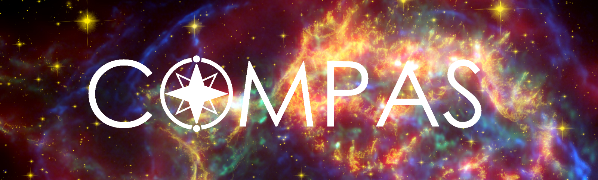



## Below is a brief overview of my CV. <a href="../files/Reinhold_Willcox_CV.pdf" target="_blank">Full version.</a>

Education
======
- 2023\. Ph.D. in Binary Stellar Astrophysics, Monash University, Australia.
- 2012\. B.Sc. in Mathematics & Physics, McGill University, Canada.

Research experience
======
* Sep 2023 -- Current: Postdoctoral Researcher
  * KU Leuven University, Belgium.
  * Sponsors: Prof. Hugues Sana & Asst. Prof. Pablo Marchant (UGhent)
  * Duties included: 
    * Research & software development
    * Teaching & supervision of master's and bachelors students
    * Telescope operator

* Jan 2019 -- Jan 2023: Ph.D. student 
  * Monash University, Australia
  * Supervisor: Prof. Ilya Mandel
  * Duties included: 
    * Research & software development
    * Teaching assistant

Software I actively develop
======

* COMPAS: Rapid binary population synthesis 

* Sidekicks.jl: Bayesian inference for inert black hole binaries 

